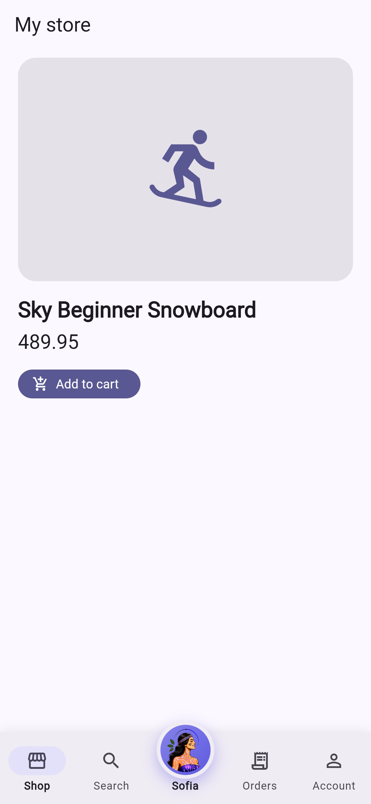
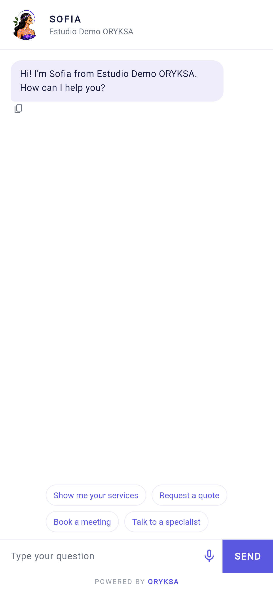
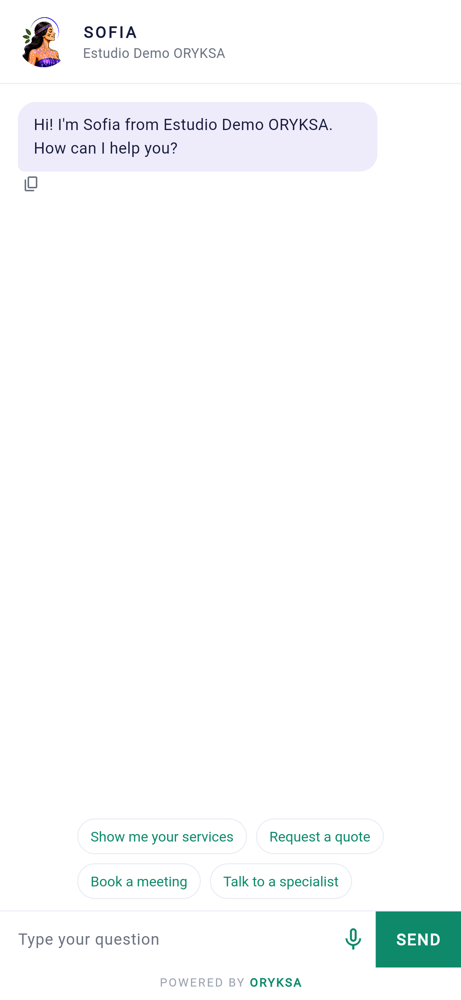

<p align="center"></p>

# oryksa

[](README.md) [](README.pt.md) [](README.es.md) [](README.fr.md)

<p align="center"><a href="https://developer.oryksa.com/es/sdks"></a></p>

SDK oficial de Flutter de **ORYKSA AI Employees**. Pon dentro de tu app Flutter (Android, iOS, web y escritorio) un empleado de IA que ya conoce tu negocio: una burbuja redonda con la foto de tu IA en el centro de tu barra de pestañas, un chat listo con el mismo aspecto que el chat de la web de ORYKSA, el nombre y la foto de tu IA desde tu cuenta ORYKSA, en inglés, portugués y español.

* Documentación: https://developer.oryksa.com/es/sdks
* API: `https://api.oryksa.com/v1`

## Capturas de pantalla

<p align="center">  </p>

Pantallas reales de la app de ejemplo de este repositorio (`example/`), compilada para la web por el CI y capturada en Chrome a tamaño de móvil con una cuenta de prueba de ORYKSA. El chat verde usa el código de *Colores y tema*, más abajo.

## Instalar

```bash
flutter pub add oryksa
```

## Para qué sirve

El SDK pone el chat y la voz de ORYKSA dentro de tu app para atender a los **clientes de tu negocio**: preguntan, compran y reservan. La IA responde con tu Brain, tus productos y tus servicios, con el nombre, la foto y la voz que elegiste en *Tu IA*, y guarda leads, reservas y ventas en las Actividades de tu cuenta ORYKSA. **No** es una interfaz para el dueño: a través del SDK nadie cambia ajustes, lee las Actividades ni da órdenes a ORYKSA. Más información: https://help.oryksa.com/es/a/sdks-what-they-do

Las palabrotas que escribe el cliente aparecen con asteriscos en el chat (la misma lista de todos los chats de ORYKSA, cargada desde `https://app.oryksa.com/widget/profanity.json` y guardada 24 horas). Las respuestas de la IA ya vienen filtradas desde el servidor.

## Burbuja en la barra de pestañas (1.2)

La burbuja redonda con la foto de tu IA en el centro de la barra de pestañas inferior, igual que en la app de ORYKSA. Al tocarla se abre el chat (con el micrófono para la voz): pantalla completa en el móvil, panel lateral en pantallas anchas (840 dp o más: tablets, plegables abiertos, escritorio), para que tu app siga visible al lado. El nombre y la foto vienen de *Tu IA* en tu cuenta ORYKSA.

<p align="center"></p>

Cambia tu `NavigationBar` por `OryksaBottomBar` (los mismos elementos `NavigationDestination`):

```dart
final client = OryksaClient(getToken: myBackend.fetchOryksaToken); // devuelve "oryk_cs_..."

bottomNavigationBar: OryksaBottomBar(
  client: client,
  selectedIndex: tab,
  onDestinationSelected: (i) => setState(() => tab = i),
  destinations: const [
    NavigationDestination(icon: Icon(Icons.home_outlined), label: 'Home'),
    NavigationDestination(icon: Icon(Icons.search), label: 'Search'),
    NavigationDestination(icon: Icon(Icons.receipt_long_outlined), label: 'Orders'),
    NavigationDestination(icon: Icon(Icons.person_outline), label: 'Account'),
  ],
),
```

¿Ya tienes tu propia barra? Pon `OryksaTabBubble` en el centro:

```dart
// en la Row de tu barra
Row(children: [...leftTabs, OryksaTabBubble(client: client, showLabel: true, borderColor: barColor), ...rightTabs]);

// o acoplada en una BottomAppBar
floatingActionButton: OryksaTabBubble(client: client),
floatingActionButtonLocation: FloatingActionButtonLocation.centerDocked,
```

* `lang`: `en`, `pt`, `br` o `es` (o una etiqueta de configuración regional como `pt-BR`). Déjalo en null para seguir el idioma de la app (añade `flutter_localizations` y tus `supportedLocales`, como en el ejemplo).
* `theme`: null sigue el tema claro u oscuro de la app (`OryksaChatTheme()` / `OryksaChatTheme.dark()`); pasa uno para usar tus colores.
* `unread: true` muestra un punto en la burbuja (por ejemplo, después de un push de tu servidor con el webhook `message.replied`); quítalo en `onBubbleOpen` / `onOpen`.
* `appContext`: la pantalla en la que está el cliente, enviada con cada mensaje (ver más abajo).
* Los lectores de pantalla oyen "Talk to Sofia" ("Falar com Sofia", "Hablar con Sofia", más "new message" cuando hay un mensaje nuevo). En las apps de derecha a izquierda, el panel lateral aparece a la izquierda.
* Abre el mismo chat desde cualquier lugar con `showOryksaChatScreen(context, client: client)`.

**Foto de la IA o logo de la empresa (1.2.1).** Por defecto, la burbuja muestra la foto de tu IA. Para mostrar en su lugar el logo de tu empresa, elige "Logo de la empresa" en el panel de ORYKSA (Conectores > Chat del sitio): la burbuja muestra el logo entero sobre fondo blanco, con el nombre de tu negocio debajo. El chat que se abre mantiene la foto y el nombre de tu IA. Tu app también puede forzar una imagen con `image:` en `OryksaTabBubble` (o `bubbleImage:` en `OryksaBottomBar`), por ejemplo `bubbleImage: const AssetImage('assets/logo.png')`.

## Voz y contexto de la app (1.1)

El chat muestra un micrófono cuando tu plan incluye voz. Abre la pantalla de voz con el mismo comportamiento que la app de ORYKSA: el micrófono sigue abierto mientras ella habla y solo una voz humana la interrumpe (el tecleo, la televisión y su propio eco no); se detiene en la palabra y el texto queda en el chat; a un susurro responde con un susurro; si su voz falla, se muestra el texto (nunca una voz robótica).

Permisos de micrófono y altavoz: Android `<uses-permission android:name="android.permission.RECORD_AUDIO"/>` y `<uses-permission android:name="android.permission.MODIFY_AUDIO_SETTINGS"/>` (su voz por el altavoz durante la conversación; sin él, la voz sale como multimedia), iOS `NSMicrophoneUsageDescription` en Info.plist. El botón de adjuntar (foto de la galería, cámara, documento; activo por defecto, `attachments: false` lo oculta) necesita `NSCameraUsageDescription` y `NSPhotoLibraryUsageDescription` en Info.plist; en Android no hace falta nada más.

```dart
OryksaChatButton(
  client: client,
  lang: 'pt',
  // la pantalla en la que está el cliente, para que la IA responda sobre ella
  appContext: () => const OryksaAppContext(screen: 'product', title: 'Sky Beginner Snowboard, 489.95'),
)
```

## Enlaces con botón Abrir (1.2.5)

Los enlaces que da la IA se pueden tocar en el chat, y cada uno tiene una tarjeta debajo de su respuesta con la foto y el título de la página y un botón **Abrir** (las páginas de tu propio sitio, los dominios de tu chat web; otros sitios muestran la dirección). La pantalla de voz muestra lo que ella dice sin las direcciones, con las mismas tarjetas. Pasa `onLink` para abrir tus propias pantallas, por ejemplo la página del producto: devuelve true cuando tu app lo abrió, false para que lo abra el navegador.

```dart
OryksaTabBubble(
  client: client,
  onLink: (uri) {
    final id = myProductIdOf(uri); // tus rutas
    if (id == null) return false;
    Navigator.of(context).pushNamed('/product', arguments: id);
    return true;
  },
)
```

## Tus funciones de IA: `client.ai` (1.2.6)

Haz que la IA haga lo que tu app necesita (leer una foto, extraer datos, clasificar, traducir, escribir) y paga con interacciones ORYKSA: 1 por respuesta. Tu prompt y tu JSON Schema viven en tu app; basta el token de sesión (nunca lleves la clave secreta). No crea una conversación en tu bandeja.

```dart
final r = await client.ai(
  instructions: 'Read the tyre on the photo: brand, model and size exactly as written on the sidewall. '
      'If the size is not legible, readable=false and size=null. Never invent.',
  images: [OryksaImage(photoBytes)], // JPEG, 1600 px
  schema: {
    'type': 'object',
    'properties': {
      'readable': {'type': 'boolean'},
      'brand': {'type': ['string', 'null']},
      'size': {'type': ['string', 'null']},
    },
    'required': ['readable', 'brand', 'size'],
  },
);
if (r.json?['readable'] == true) showProductsFor(r.json!['size'] as String);
```

`r.text` trae la respuesta en texto, `r.json` el objeto (con schema) y `r.interactionsSpent` las interacciones usadas. Cuando se agotan las interacciones del plan, la llamada lanza `OryksaException` con el status 402.

## Apps de TV: `package:oryksa/tv.dart` (Android TV, Google TV, Fire TV)

Lo que la IA hace en cualquier app de TV, solo con el mando (flechas, OK y Atrás), con letra grande y un foco que se ve desde el sofá. Son widgets nativos de Flutter, sin web view. Los textos, las voces, las reglas y los botones vienen de tu cuenta ORYKSA.

* **Presentadora**: la IA habla en pantalla con una voz nativa en el idioma de quien está mirando, con subtítulos grandes. Las frases que ya dijo vuelven a sonar desde el dispositivo, sin generar una voz nueva, y se cobran otra vez cada vez que las dice.
* **Panel de asistente**: una conversación con la IA pensada para el mando.
* **Voz por el móvil**: muchas TVs no dan micrófono a las apps (el Fire TV Stick no lo da). La TV muestra un código QR, el móvil abre la página de ORYKSA y lo que dice la persona llega a tu app como texto.
* **`client.ai`** para tus propias tareas, por ejemplo moderar o clasificar.

```dart
import 'package:oryksa/tv.dart';

// Un paquete solo de Dart no distingue un Fire TV de un Android TV: es tu app la que dice cuál es.
final client = OryksaClient(getToken: tokenDeTuServidor, platform: OryksaTvPlatform.fireTv.wire);
final tv = OryksaTv(client: client, locale: 'es-ES');

// La presentadora: pon OryksaPresenterView encima de tu pantalla.
Stack(children: [tuPantalla, OryksaPresenterView(tv: tv)]);
await tv.presenter.say('¡Bienvenidos! Soy vuestra presentadora esta noche.');
await tv.presenter.sayGenerated(instructions: 'Anuncia la próxima ronda en una frase corta.', input: 'Ronda 2');
// Solo subtítulos, sin sonido (se cobra al precio de texto; una frase con voz se cobra al precio de voz).
await tv.presenter.say('El tema de esta noche: viajes.', voice: false);

// El panel de asistente (Atrás lo cierra y el foco vuelve adonde estaba).
showOryksaTvAssistant(context, tv: tv);

// El móvil como micrófono.
tv.phoneVoice.texts.listen((texto) => cuandoElEspectadorDijo(texto));
showDialog(context: context, builder: (_) => Dialog(child: OryksaPairingCard(tv: tv)));
```

* **Sin servidor propio**: `OryksaClient.public(chatToken: ..., conversationId: ..., platform: OryksaTvPlatform.fireTv.wire, appId: 'tu.package')` abre una sesión pública con el token público del chat de tu negocio. Cuando tu negocio limita el chat, debe poner tu package en la lista de apps permitidas. `appId` es un filtro, no una seguridad fuerte (se puede imitar): la seguridad fuerte es que el token venga de tu propio servidor (`POST /v1/sessions`).
* **Idiomas**: el servidor de ORYKSA elige la voz y los textos para el locale. Hay voces nativas para pt-BR, pt-PT, es-ES, es-419, fr-FR, de-DE, en-US y en-GB, y los demás idiomas usan la voz de inglés de EE. UU.
* **Interacciones**: cada frase de la presentadora se cobra según la tabla de costes de interacción de ORYKSA cada vez que la dice o la muestra (por cada trozo de hasta 600 caracteres), también la frase repetida y la frase solo con subtítulos: la frase con voz al precio de voz y la frase solo con subtítulos al precio de texto. El número exacto viene en la cabecera `X-ORYKSA-Interactions-Spent`, y una frase que el servidor no contó no aparece. Cada texto oído en el móvil, cada respuesta del chat y cada respuesta de `client.ai` también se cobran.
* **Mientras habla**, OK y Atrás en el mando la callan (`remoteSkips: false` lo desactiva). Usa `tv.presenter.onStart` y `onEnd` para bajar tu música o tu vídeo.
* **Micrófono de la TV**: `OryksaTvMic.isAvailable()` dice si el dispositivo tiene una entrada de audio. El SDK nunca pide el permiso en una TV que no la tiene.
* **AndroidManifest**: declara el micrófono, la pantalla táctil y leanback como no obligatorios, para que las tiendas no oculten tu app en las TVs que no los tienen, y añade la categoría del lanzador de TV con un banner. Mira `example_tv/` en el repositorio.

```xml
<uses-feature android:name="android.hardware.microphone" android:required="false"/>
<uses-feature android:name="android.hardware.touchscreen" android:required="false"/>
<uses-feature android:name="android.software.leanback" android:required="false"/>
<!-- en el intent-filter de la actividad -->
<category android:name="android.intent.category.LEANBACK_LAUNCHER"/>
```

Para pruebas y demostraciones, `OryksaTv.withBackend(OryksaTvFakeBackend())` lo ejecuta todo sin el servidor. Es simulado, así que no demuestra nada sobre tu cuenta ORYKSA.

## Cómo funciona (y por qué la clave está segura)

1. Tu **servidor** guarda la clave secreta de la API (`oryk_live_...`, creada en developer.oryksa.com) y crea un **token de sesión** de corta duración para cada usuario que ha iniciado sesión, con `POST /v1/sessions`.
2. Tu **app** recibe solo ese token de sesión (`oryk_cs_...`) y habla con ORYKSA con él. La clave secreta nunca entra en la app.
3. Cada respuesta de la IA cuenta como una interacción de tu plan ORYKSA, igual que en WhatsApp.

## En la app

```dart
import 'package:oryksa/oryksa.dart';

final client = OryksaClient(
  getToken: () async => await myBackend.fetchOryksaToken(), // devuelve "oryk_cs_..."
);

Scaffold(
  body: MyScreen(),
  floatingActionButton: OryksaChatButton(client: client, lang: 'en'), // en, pt, br, es
);
```

Ábrelo desde tu propio botón con `showOryksaChat(context, client: client)`, o coloca el panel en cualquier lugar con `OryksaChat(client: client)`. Cambia los colores con `OryksaChatTheme`.

Sin la interfaz:

```dart
final agent = await client.agent();            // nombre, foto, saludo, sugerencias
final text = await client.sendAndWait('Are you open on Saturday?');
final history = await client.messages();
```

## En tu servidor Dart (clave secreta)

Las funciones de servidor están en una biblioteca aparte, **solo para tu backend**: nunca la importes en la app. La biblioteca de la app (`package:oryksa/oryksa.dart`) atiende solo a tus clientes y no puede cambiar la IA ni su Brain.

```dart
import 'package:oryksa/oryksa_server.dart';

final oryksa = Oryksa(Platform.environment['ORYKSA_API_KEY']!);

// token de sesión para un usuario (envía a la app solo client_token)
final s = await oryksa.createSession(conversationId: 'user-42', customerName: 'Ana');

// mantén la IA sincronizada con tu app (llámalo en cada versión)
await oryksa.learnApp(
  name: 'FitTrack',
  description: 'Fitness app to log workouts and follow training plans.',
  screens: [{'title': 'Workouts', 'content': 'Tap + to log a workout.'}],
  faq: [{'question': 'How do I cancel Premium?', 'answer': 'Settings > Subscription > Cancel.'}],
);
```

Los servidores en otros lenguajes pueden llamar a la misma API: consulta https://developer.oryksa.com.

## Webhooks

```dart
import 'package:oryksa/oryksa_server.dart';

final event = verifyWebhook(rawBody, request.headers['oryksa-signature'], webhookSecret);
```

## Errores

Toda llamada que falla lanza `OryksaException` con `status`, `code` (por ejemplo `interaction_limit_reached`, `rate_limited`, `plan_required`) y `message`.

## Colores y tema

`OryksaChatTheme` tiene seis colores: `accent` (botones, burbujas del visitante, enlaces), `ink` (texto principal), `soft` (burbujas de la IA), `background` (panel), `muted` (texto secundario) y `line` (separadores). `OryksaChatTheme()` es la versión clara y `OryksaChatTheme.dark()` la oscura. Pasa el tema a `OryksaChatButton`, `OryksaChat`, `showOryksaChat` u `OryksaTabBubble`.

```dart
// Your own colors (light)
OryksaChatButton(
  client: client,
  theme: const OryksaChatTheme(accent: Color(0xFF0E8A6B)),
);

// Dark version, with your accent
OryksaChatButton(
  client: client,
  theme: const OryksaChatTheme.dark(accent: Color(0xFF3DD9A8)),
);
```

`OryksaTabBubble` y `showOryksaChatScreen` siguen el tema claro u oscuro de tu app cuando no pasas ningún tema (`OryksaChatTheme.of(context)`).

---

## Sobre el autor

**Weslley Harakawa** - Fundador de ORYKSA AI. En Lisboa, Portugal. Especialidades: inteligencia artificial, desarrollo web y móvil, tokenización en blockchain. Formación: University of the People.

- LinkedIn: https://www.linkedin.com/in/weslleyharakawa/
- ORYKSA AI Employees: https://oryksa.com (X: https://x.com/oryksa, Instagram: https://www.instagram.com/oryksaai, YouTube: https://www.youtube.com/@ORYKSA)

---

MIT License · ORYKSA AI Employees · W8 Atlantic Unipessoal Lda
