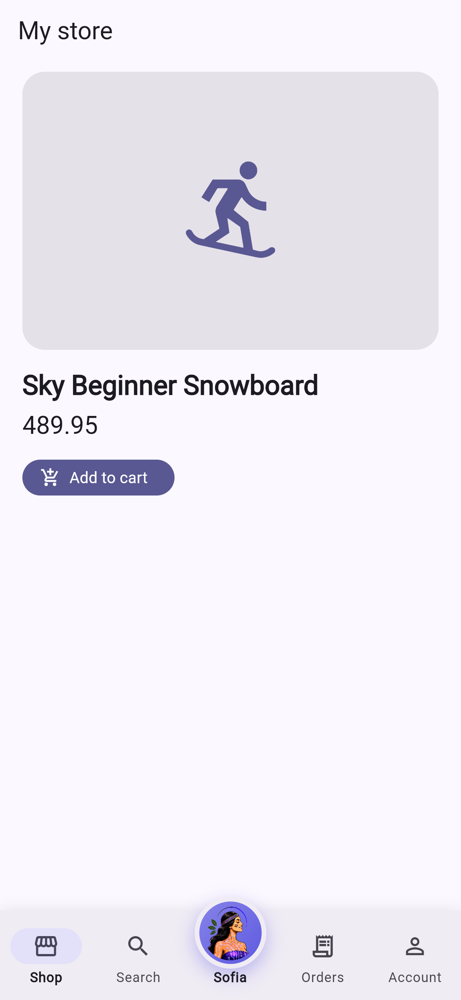
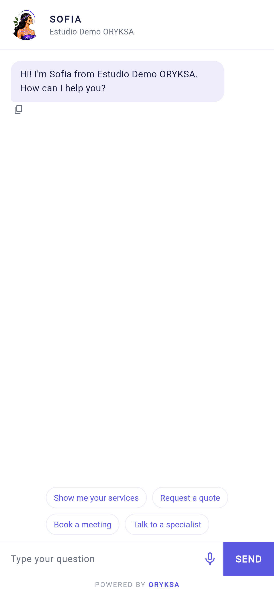
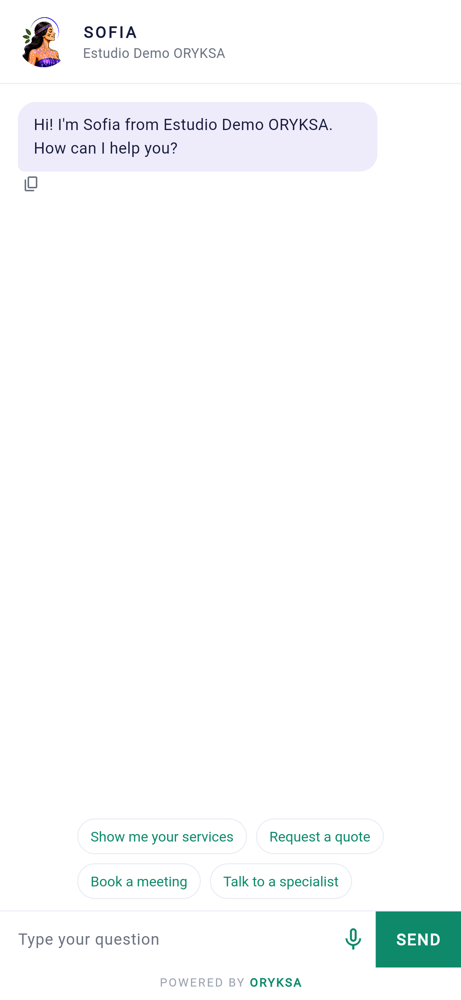

<p align="center"></p>

# oryksa

[](README.md) [](README.pt.md) [](README.es.md) [](README.fr.md)

<p align="center"><a href="https://developer.oryksa.com/fr/sdks"></a></p>

SDK Flutter officiel d'**ORYKSA AI Employees**. Mettez dans votre app Flutter (Android, iOS, web et ordinateur) un employé IA qui connaît déjà votre entreprise : une bulle ronde avec la photo de votre IA au milieu de votre barre d'onglets, un chat prêt à l'emploi identique au chat du site ORYKSA, le nom et la photo de votre IA issus de votre compte ORYKSA, en anglais, portugais et espagnol.

* Documentation : https://developer.oryksa.com/fr/sdks
* API : `https://api.oryksa.com/v1`

## Captures d'écran

<p align="center">  </p>

Écrans réels de l'app d'exemple de ce dépôt (`example/`), compilée pour le web par la CI et capturée dans Chrome au format téléphone avec un compte de test ORYKSA. Le chat vert utilise le code de *Couleurs et thème*, plus bas.

## Installer

```bash
flutter pub add oryksa
```

## À quoi il sert

Le SDK met le chat et la voix ORYKSA dans votre app pour servir les **clients de votre entreprise** : ils posent des questions, achètent et réservent. L'IA répond avec votre Brain, vos produits et vos services, avec le nom, la photo et la voix que vous avez choisis dans *Votre IA*, et enregistre les leads, réservations et ventes dans les Activités de votre compte ORYKSA. Ce n'est **pas** une interface pour le propriétaire : via le SDK, personne ne modifie les paramètres, ne lit les Activités ni ne donne d'ordres à ORYKSA. En savoir plus : https://help.oryksa.com/fr/a/sdks-what-they-do

Les gros mots que le client tape apparaissent sous forme d'astérisques dans le chat (la même liste que tous les chats ORYKSA, chargée depuis `https://app.oryksa.com/widget/profanity.json`, conservée 24 heures). Les réponses de l'IA arrivent déjà filtrées par le serveur.

## Bulle dans la barre d'onglets (1.2)

La bulle ronde avec la photo de votre IA au milieu de la barre d'onglets du bas, comme dans l'app ORYKSA. Un appui ouvre le chat (avec le micro pour la voix) : plein écran sur le téléphone, panneau latéral sur les grands écrans (840 dp ou plus : tablettes, pliables ouverts, ordinateurs), pour que votre app reste visible à côté. Le nom et la photo viennent de *Votre IA* dans votre compte ORYKSA.

<p align="center"></p>

Remplacez votre `NavigationBar` par `OryksaBottomBar` (mêmes éléments `NavigationDestination`) :

```dart
final client = OryksaClient(getToken: myBackend.fetchOryksaToken); // renvoie "oryk_cs_..."

bottomNavigationBar: OryksaBottomBar(
  client: client,
  selectedIndex: tab,
  onDestinationSelected: (i) => setState(() => tab = i),
  destinations: const [
    NavigationDestination(icon: Icon(Icons.home_outlined), label: 'Home'),
    NavigationDestination(icon: Icon(Icons.search), label: 'Search'),
    NavigationDestination(icon: Icon(Icons.receipt_long_outlined), label: 'Orders'),
    NavigationDestination(icon: Icon(Icons.person_outline), label: 'Account'),
  ],
),
```

Vous avez déjà votre propre barre ? Placez `OryksaTabBubble` en son milieu :

```dart
// dans la Row de votre barre
Row(children: [...leftTabs, OryksaTabBubble(client: client, showLabel: true, borderColor: barColor), ...rightTabs]);

// ou ancrée dans une BottomAppBar
floatingActionButton: OryksaTabBubble(client: client),
floatingActionButtonLocation: FloatingActionButtonLocation.centerDocked,
```

* `lang` : `en`, `pt`, `br` ou `es` (ou un code de langue tel que `pt-BR`). Laissez-le à null pour suivre la langue de l'app (ajoutez `flutter_localizations` et vos `supportedLocales`, comme dans l'exemple).
* `theme` : null suit le thème clair ou sombre de l'app (`OryksaChatTheme()` / `OryksaChatTheme.dark()`) ; passez-en un pour utiliser vos couleurs.
* `unread: true` affiche un point sur la bulle (par exemple après un push de votre serveur sur le webhook `message.replied`) ; effacez-le dans `onBubbleOpen` / `onOpen`.
* `appContext` : l'écran sur lequel se trouve le client, envoyé avec chaque message (voir ci-dessous).
* Les lecteurs d'écran annoncent "Talk to Sofia" ("Falar com Sofia", "Hablar con Sofia", plus "new message" quand il y en a un). Les apps de droite à gauche ont le panneau latéral à gauche.
* Ouvrez le même chat depuis n'importe où avec `showOryksaChatScreen(context, client: client)`.

**Photo de l'IA ou logo de l'entreprise (1.2.1).** Par défaut, la bulle affiche la photo de votre IA. Pour afficher plutôt le logo de votre entreprise, choisissez "Logo de l'entreprise" dans le panneau ORYKSA (Connecteurs > Chat du site) : la bulle affiche le logo en entier sur fond blanc, avec le nom de votre entreprise en dessous. Le chat qui s'ouvre garde la photo et le nom de votre IA. Votre app peut aussi imposer une image avec `image:` sur `OryksaTabBubble` (ou `bubbleImage:` sur `OryksaBottomBar`), par exemple `bubbleImage: const AssetImage('assets/logo.png')`.

## Voix et contexte de l'app (1.1)

Le chat affiche un micro quand votre forfait inclut la voix. Il ouvre l'écran vocal avec le même comportement que l'app ORYKSA : le micro reste ouvert pendant qu'elle parle et seule une voix humaine l'interrompt (la frappe au clavier, la télévision et son propre écho ne l'interrompent pas) ; elle s'arrête sur le mot et le texte reste dans le chat ; à un chuchotement, elle répond en chuchotant ; si sa voix échoue, le texte est affiché (jamais une voix robotique).

Autorisations du micro et du haut-parleur : Android `<uses-permission android:name="android.permission.RECORD_AUDIO"/>` et `<uses-permission android:name="android.permission.MODIFY_AUDIO_SETTINGS"/>` (sa voix sur le haut-parleur pendant la conversation ; sans elle, la voix sort comme un média), iOS `NSMicrophoneUsageDescription` dans Info.plist. Le bouton pour joindre un fichier (photo de la galerie, appareil photo, document ; actif par défaut, `attachments: false` le masque) a besoin de `NSCameraUsageDescription` et `NSPhotoLibraryUsageDescription` dans Info.plist ; rien de plus sur Android.

```dart
OryksaChatButton(
  client: client,
  lang: 'pt',
  // l'écran sur lequel se trouve le client, pour que l'IA réponde à son sujet
  appContext: () => const OryksaAppContext(screen: 'product', title: 'Sky Beginner Snowboard, 489.95'),
)
```

## Liens avec un bouton pour les ouvrir (1.2.5)

Les liens que donne l'IA se touchent dans le chat, et chacun a une carte sous sa réponse avec la photo et le titre de la page et un bouton pour l'ouvrir (les pages de votre propre site, les domaines de votre chat web ; les autres sites montrent l'adresse). L'écran vocal montre ce qu'elle dit sans les adresses, avec les mêmes cartes. Passez `onLink` pour ouvrir vos propres écrans, par exemple la page du produit : renvoyez true quand votre app l'a ouvert, false pour laisser le navigateur l'ouvrir.

```dart
OryksaTabBubble(
  client: client,
  onLink: (uri) {
    final id = myProductIdOf(uri); // vos routes
    if (id == null) return false;
    Navigator.of(context).pushNamed('/product', arguments: id);
    return true;
  },
)
```

## Vos propres fonctions d'IA : `client.ai` (1.2.6)

Faites faire à l'IA ce dont votre app a besoin (lire une photo, extraire des données, classer, traduire, rédiger) et payez en interactions ORYKSA : 1 par réponse. Votre prompt et votre JSON Schema restent dans votre app ; le jeton de session suffit (n'embarquez jamais la clé secrète). Aucune conversation n'est créée dans votre boîte.

```dart
final r = await client.ai(
  instructions: 'Read the tyre on the photo: brand, model and size exactly as written on the sidewall. '
      'If the size is not legible, readable=false and size=null. Never invent.',
  images: [OryksaImage(photoBytes)], // JPEG, 1600 px
  schema: {
    'type': 'object',
    'properties': {
      'readable': {'type': 'boolean'},
      'brand': {'type': ['string', 'null']},
      'size': {'type': ['string', 'null']},
    },
    'required': ['readable', 'brand', 'size'],
  },
);
if (r.json?['readable'] == true) showProductsFor(r.json!['size'] as String);
```

`r.text` contient la réponse en texte, `r.json` l'objet (avec un schema) et `r.interactionsSpent` les interactions utilisées. Quand les interactions du forfait sont épuisées, l'appel lève une `OryksaException` avec le status 402.

## Apps TV : `package:oryksa/tv.dart` (Android TV, Google TV, Fire TV)

Ce que l'IA fait dans n'importe quelle app TV, uniquement avec la télécommande (flèches, OK et Retour), avec de gros caractères et un focus visible depuis le canapé. Ce sont des widgets Flutter natifs, sans web view. Les textes, les voix, les règles et les boutons viennent de votre compte ORYKSA.

* **Présentatrice** : l'IA parle à l'écran avec une voix native dans la langue du spectateur, avec de grands sous-titres. Les phrases déjà dites sont rejouées depuis l'appareil, sans nouvelle voix, et sont facturées à nouveau chaque fois qu'elle les dit.
* **Panneau d'assistant** : une conversation avec l'IA pensée pour la télécommande.
* **Voix par le téléphone** : beaucoup de TV ne donnent pas de micro aux apps (le Fire TV Stick n'en donne pas). La TV affiche un QR code, le téléphone ouvre la page ORYKSA et ce que dit la personne arrive dans votre app sous forme de texte.
* **`client.ai`** pour vos propres tâches, par exemple modérer ou classer.

```dart
import 'package:oryksa/tv.dart';

// Un paquet uniquement Dart ne distingue pas un Fire TV d'une Android TV : c'est votre app qui le dit.
final client = OryksaClient(getToken: tokenDeVotreServeur, platform: OryksaTvPlatform.fireTv.wire);
final tv = OryksaTv(client: client, locale: 'fr-FR');

// La présentatrice : placez OryksaPresenterView au-dessus de votre écran.
Stack(children: [votreEcran, OryksaPresenterView(tv: tv)]);
await tv.presenter.say('Bienvenue ! Je suis votre présentatrice ce soir.');
await tv.presenter.sayGenerated(instructions: 'Annonce la manche suivante en une phrase courte.', input: 'Manche 2');
// Sous-titres seuls, sans son (facturée au prix du texte ; une phrase avec voix est facturée au prix de la voix).
await tv.presenter.say('Le thème de ce soir : les voyages.', voice: false);

// Le panneau d'assistant (Retour le ferme et le focus revient là où il était).
showOryksaTvAssistant(context, tv: tv);

// Le téléphone comme micro.
tv.phoneVoice.texts.listen((texte) => quandLeSpectateurADit(texte));
showDialog(context: context, builder: (_) => Dialog(child: OryksaPairingCard(tv: tv)));
```

* **Sans serveur à vous** : `OryksaClient.public(chatToken: ..., conversationId: ..., platform: OryksaTvPlatform.fireTv.wire, appId: 'votre.package')` ouvre une session publique avec le token public du chat de votre entreprise. Quand votre entreprise limite son chat, elle doit mettre votre package dans la liste des apps autorisées. `appId` est un filtre, pas une sécurité forte (il peut être imité) : la sécurité forte, c'est un token qui vient de votre propre serveur (`POST /v1/sessions`).
* **Langues** : le serveur ORYKSA choisit la voix et les textes pour la locale. Il y a des voix natives pour pt-BR, pt-PT, es-ES, es-419, fr-FR, de-DE, en-US et en-GB, et les autres langues utilisent la voix anglaise des États-Unis.
* **Interactions** : chaque phrase de la présentatrice est facturée selon la grille des coûts d'interaction ORYKSA chaque fois qu'elle la dit ou l'affiche (par morceau de 600 caractères au plus), la phrase répétée et la phrase en sous-titres seuls aussi : la phrase avec voix au prix de la voix, la phrase en sous-titres seuls au prix du texte. Le nombre exact arrive dans l'en-tête `X-ORYKSA-Interactions-Spent`, et une phrase que le serveur n'a pas comptée n'apparaît pas. Chaque texte entendu sur le téléphone, chaque réponse du chat et chaque réponse de `client.ai` sont aussi facturés.
* **Pendant qu'elle parle**, OK et Retour sur la télécommande la font taire (`remoteSkips: false` désactive cela). Utilisez `tv.presenter.onStart` et `onEnd` pour baisser votre musique ou votre vidéo.
* **Micro de la TV** : `OryksaTvMic.isAvailable()` indique si l'appareil a une entrée audio. Le SDK ne demande jamais l'autorisation sur une TV qui n'en a pas.
* **AndroidManifest** : déclarez le micro, l'écran tactile et leanback comme non obligatoires, pour que les stores ne cachent pas votre app sur les TV qui ne les ont pas, et ajoutez la catégorie du lanceur TV avec une bannière. Voir `example_tv/` dans le dépôt.

```xml
<uses-feature android:name="android.hardware.microphone" android:required="false"/>
<uses-feature android:name="android.hardware.touchscreen" android:required="false"/>
<uses-feature android:name="android.software.leanback" android:required="false"/>
<!-- dans l'intent-filter de l'activité -->
<category android:name="android.intent.category.LEANBACK_LAUNCHER"/>
```

Pour les tests et les démos, `OryksaTv.withBackend(OryksaTvFakeBackend())` fait tout tourner sans le serveur. C'est simulé, donc cela ne prouve rien sur votre compte ORYKSA.

## Comment ça marche (et pourquoi la clé reste en sécurité)

1. Votre **serveur** garde la clé API secrète (`oryk_live_...`, créée sur developer.oryksa.com) et crée un **jeton de session** de courte durée pour chaque utilisateur connecté avec `POST /v1/sessions`.
2. Votre **app** ne reçoit que ce jeton de session (`oryk_cs_...`) et communique avec ORYKSA grâce à lui. La clé secrète n'entre jamais dans l'app.
3. Chaque réponse de l'IA compte comme une interaction de votre forfait ORYKSA, comme sur WhatsApp.

## Dans l'app

```dart
import 'package:oryksa/oryksa.dart';

final client = OryksaClient(
  getToken: () async => await myBackend.fetchOryksaToken(), // renvoie "oryk_cs_..."
);

Scaffold(
  body: MyScreen(),
  floatingActionButton: OryksaChatButton(client: client, lang: 'en'), // en, pt, br, es
);
```

Ouvrez-le depuis votre propre bouton avec `showOryksaChat(context, client: client)`, ou placez le panneau n'importe où avec `OryksaChat(client: client)`. Changez les couleurs avec `OryksaChatTheme`.

Sans l'interface :

```dart
final agent = await client.agent();            // nom, photo, message d'accueil, suggestions
final text = await client.sendAndWait('Are you open on Saturday?');
final history = await client.messages();
```

## Sur votre serveur Dart (clé secrète)

Les fonctions serveur forment une bibliothèque séparée, **réservée à votre backend** : ne l'importez jamais dans l'app. La bibliothèque de l'app (`package:oryksa/oryksa.dart`) sert uniquement vos clients et ne peut modifier ni l'IA ni son Brain.

```dart
import 'package:oryksa/oryksa_server.dart';

final oryksa = Oryksa(Platform.environment['ORYKSA_API_KEY']!);

// jeton de session pour un utilisateur (envoyez uniquement client_token à l'app)
final s = await oryksa.createSession(conversationId: 'user-42', customerName: 'Ana');

// gardez l'IA synchronisée avec votre app (appelez-le à chaque version)
await oryksa.learnApp(
  name: 'FitTrack',
  description: 'Fitness app to log workouts and follow training plans.',
  screens: [{'title': 'Workouts', 'content': 'Tap + to log a workout.'}],
  faq: [{'question': 'How do I cancel Premium?', 'answer': 'Settings > Subscription > Cancel.'}],
);
```

Les serveurs écrits dans d'autres langages peuvent appeler la même API : voir https://developer.oryksa.com.

## Webhooks

```dart
import 'package:oryksa/oryksa_server.dart';

final event = verifyWebhook(rawBody, request.headers['oryksa-signature'], webhookSecret);
```

## Erreurs

Chaque appel qui échoue lève `OryksaException` avec `status`, `code` (par exemple `interaction_limit_reached`, `rate_limited`, `plan_required`) et `message`.

## Couleurs et thème

`OryksaChatTheme` a six couleurs : `accent` (boutons, bulles du visiteur, liens), `ink` (texte principal), `soft` (bulles de l'IA), `background` (panneau), `muted` (texte secondaire) et `line` (séparateurs). `OryksaChatTheme()` est la version claire et `OryksaChatTheme.dark()` la version sombre. Passez le thème à `OryksaChatButton`, `OryksaChat`, `showOryksaChat` ou `OryksaTabBubble`.

```dart
// Your own colors (light)
OryksaChatButton(
  client: client,
  theme: const OryksaChatTheme(accent: Color(0xFF0E8A6B)),
);

// Dark version, with your accent
OryksaChatButton(
  client: client,
  theme: const OryksaChatTheme.dark(accent: Color(0xFF3DD9A8)),
);
```

`OryksaTabBubble` et `showOryksaChatScreen` suivent le thème clair ou sombre de votre app quand vous ne passez aucun thème (`OryksaChatTheme.of(context)`).

---

## À propos de l'auteur

**Weslley Harakawa** - Fondateur d'ORYKSA AI. À Lisbonne, Portugal. Spécialités : intelligence artificielle, développement web et mobile, tokenisation blockchain. Formation : University of the People.

- LinkedIn: https://www.linkedin.com/in/weslleyharakawa/
- ORYKSA AI Employees: https://oryksa.com (X: https://x.com/oryksa, Instagram: https://www.instagram.com/oryksaai, YouTube: https://www.youtube.com/@ORYKSA)

---

MIT License · ORYKSA AI Employees · W8 Atlantic Unipessoal Lda
