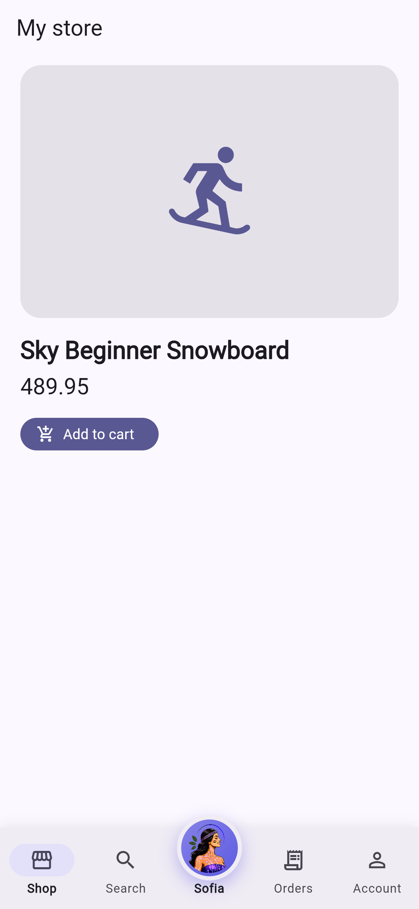
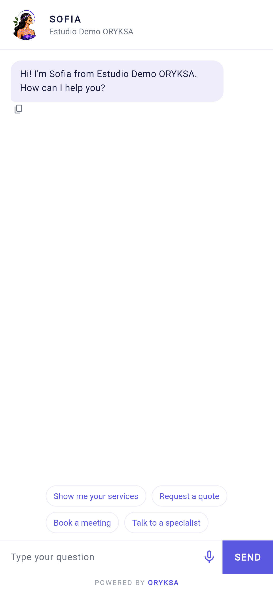
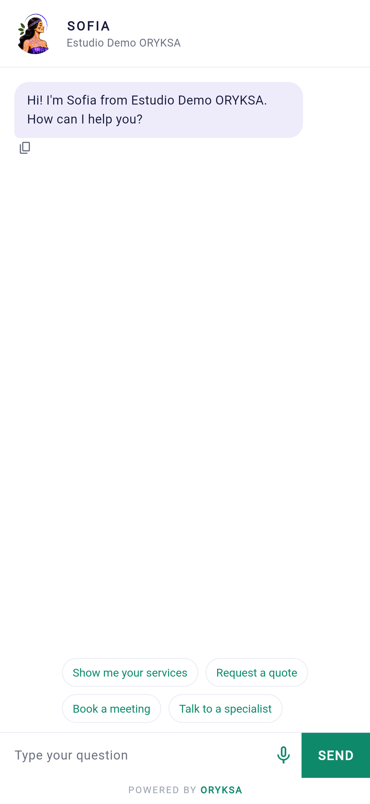

<p align="center"></p>

# oryksa

[](README.md) [](README.pt.md) [](README.es.md) [](README.fr.md)

<p align="center"><a href="https://developer.oryksa.com/en/sdks"></a></p>

Official Flutter SDK for **ORYKSA AI Employees**. Put an AI employee that already knows your business inside your Flutter app (Android, iOS, web and desktop): a round bubble with the photo of your AI in the middle of your tab bar, a ready chat with the same look as the ORYKSA website chat, the name and photo of your AI from your ORYKSA account, in English, Portuguese and Spanish.

* Docs: https://developer.oryksa.com/en/sdks
* API: `https://api.oryksa.com/v1`

## Screenshots

<p align="center">  </p>

Real screens of the example app in this repository (`example/`), built for the web by CI and captured in Chrome at phone size with an ORYKSA test account. The green chat uses the code of *Colours and theme* below.

## Install

```bash
flutter pub add oryksa
```

## What it is for

The SDK puts the ORYKSA chat and voice inside your app to serve the **customers of your business**: they ask, buy and book. The AI answers with your Brain, products and services, with the name, photo and voice you chose in *Your AI*, and saves leads, bookings and sales in the Activities of your ORYKSA account. It is **not** an interface for the owner: nobody changes settings, reads Activities or gives orders to ORYKSA through the SDK. More: https://help.oryksa.com/en/a/sdks-what-they-do

Swear words the customer types show as asterisks in the chat (the same list as every ORYKSA chat, loaded from `https://app.oryksa.com/widget/profanity.json`, kept 24 hours). The AI's replies already come filtered from the server.

## Tab bar bubble (1.2)

The round bubble with the photo of your AI in the middle of the bottom tab bar, the same as in the ORYKSA app. Tapping it opens the chat (with the microphone for voice): full screen on phones, a side panel on wide screens (840 dp or more: tablets, open foldables, desktop), so your app stays visible beside it. The name and photo come from *Your AI* in your ORYKSA account.

<p align="center"></p>

Swap your `NavigationBar` for `OryksaBottomBar` (same `NavigationDestination` items):

```dart
final client = OryksaClient(getToken: myBackend.fetchOryksaToken); // returns "oryk_cs_..."

bottomNavigationBar: OryksaBottomBar(
  client: client,
  selectedIndex: tab,
  onDestinationSelected: (i) => setState(() => tab = i),
  destinations: const [
    NavigationDestination(icon: Icon(Icons.home_outlined), label: 'Home'),
    NavigationDestination(icon: Icon(Icons.search), label: 'Search'),
    NavigationDestination(icon: Icon(Icons.receipt_long_outlined), label: 'Orders'),
    NavigationDestination(icon: Icon(Icons.person_outline), label: 'Account'),
  ],
),
```

Already have your own bar? Put `OryksaTabBubble` in the middle of it:

```dart
// in the Row of your bar
Row(children: [...leftTabs, OryksaTabBubble(client: client, showLabel: true, borderColor: barColor), ...rightTabs]);

// or docked in a BottomAppBar
floatingActionButton: OryksaTabBubble(client: client),
floatingActionButtonLocation: FloatingActionButtonLocation.centerDocked,
```

* `lang`: `en`, `pt`, `br` or `es` (or a locale tag such as `pt-BR`). Leave it null to follow the language of the app (add `flutter_localizations` and your `supportedLocales`, as in the example).
* `theme`: null follows the light or dark theme of the app (`OryksaChatTheme()` / `OryksaChatTheme.dark()`); pass one to use your colors.
* `unread: true` shows a dot on the bubble (for example after a push from your server on the `message.replied` webhook); clear it in `onBubbleOpen` / `onOpen`.
* `appContext`: the screen the customer is on, sent with each message (see below).
* Screen readers hear "Talk to Sofia" ("Falar com Sofia", "Hablar con Sofia", plus "new message" when there is one). Right-to-left apps get the side panel on the left.
* Open the same chat from anywhere with `showOryksaChatScreen(context, client: client)`.

**Photo of the AI or company logo (1.2.1).** By default the bubble shows the photo of your AI. To show your company logo instead, pick "Company logo" in the ORYKSA panel (Connectors > Website chat): the bubble shows the whole logo on white, with the name of your business under it. The chat that opens keeps the photo and name of your AI. Your app can also force an image with `image:` on `OryksaTabBubble` (or `bubbleImage:` on `OryksaBottomBar`), for example `bubbleImage: const AssetImage('assets/logo.png')`.

## Voice and app context (1.1)

The chat shows a microphone when your plan has voice. It opens the voice screen with the same behaviour as the ORYKSA app: the microphone stays open while she speaks and only a human voice cuts her off (typing, TV and her own echo do not); she stops on the word and the text stays in the chat; a whisper gets a whispered answer; if her voice fails, the text is shown (never a robot voice).

Microphone permission: Android `<uses-permission android:name="android.permission.RECORD_AUDIO"/>`, iOS `NSMicrophoneUsageDescription` in Info.plist.

```dart
OryksaChatButton(
  client: client,
  lang: 'pt',
  // the screen the customer is on, so the AI answers about it
  appContext: () => const OryksaAppContext(screen: 'product', title: 'Sky Beginner Snowboard, 489.95'),
)
```

## How it works (and why the key stays safe)

1. Your **server** keeps the secret API key (`oryk_live_...`, created at developer.oryksa.com) and creates a short-lived **session token** for each signed-in user with `POST /v1/sessions`.
2. Your **app** receives only that session token (`oryk_cs_...`) and talks to ORYKSA with it. The secret key never goes into the app.
3. Every AI reply counts as one interaction of your ORYKSA plan, the same as on WhatsApp.

## In the app

```dart
import 'package:oryksa/oryksa.dart';

final client = OryksaClient(
  getToken: () async => await myBackend.fetchOryksaToken(), // returns "oryk_cs_..."
);

Scaffold(
  body: MyScreen(),
  floatingActionButton: OryksaChatButton(client: client, lang: 'en'), // en, pt, br, es
);
```

Open it from your own button with `showOryksaChat(context, client: client)`, or place the panel anywhere with `OryksaChat(client: client)`. Change colors with `OryksaChatTheme`.

Without the UI:

```dart
final agent = await client.agent();            // name, photo, greeting, suggestions
final text = await client.sendAndWait('Are you open on Saturday?');
final history = await client.messages();
```

## On your Dart server (secret key)

Server helpers are a separate library, **only for your backend**: never import it in the app. The app library (`package:oryksa/oryksa.dart`) serves your customers only and cannot change the AI or its Brain.

```dart
import 'package:oryksa/oryksa_server.dart';

final oryksa = Oryksa(Platform.environment['ORYKSA_API_KEY']!);

// session token for one user (send only client_token to the app)
final s = await oryksa.createSession(conversationId: 'user-42', customerName: 'Ana');

// keep the AI in sync with your app (call it on every release)
await oryksa.learnApp(
  name: 'FitTrack',
  description: 'Fitness app to log workouts and follow training plans.',
  screens: [{'title': 'Workouts', 'content': 'Tap + to log a workout.'}],
  faq: [{'question': 'How do I cancel Premium?', 'answer': 'Settings > Subscription > Cancel.'}],
);
```

Servers in other languages can call the same API: see https://developer.oryksa.com.

## Webhooks

```dart
import 'package:oryksa/oryksa_server.dart';

final event = verifyWebhook(rawBody, request.headers['oryksa-signature'], webhookSecret);
```

## Errors

Every failed call throws `OryksaException` with `status`, `code` (for example `interaction_limit_reached`, `rate_limited`, `plan_required`) and `message`.

## Colours and theme

`OryksaChatTheme` has six colors: `accent` (buttons, visitor bubbles, links), `ink` (main text), `soft` (AI bubbles), `background` (panel), `muted` (secondary text) and `line` (dividers). `OryksaChatTheme()` is the light version and `OryksaChatTheme.dark()` the dark one. Pass the theme to `OryksaChatButton`, `OryksaChat`, `showOryksaChat` or `OryksaTabBubble`.

```dart
// Your own colors (light)
OryksaChatButton(
  client: client,
  theme: const OryksaChatTheme(accent: Color(0xFF0E8A6B)),
);

// Dark version, with your accent
OryksaChatButton(
  client: client,
  theme: const OryksaChatTheme.dark(accent: Color(0xFF3DD9A8)),
);
```

`OryksaTabBubble` and `showOryksaChatScreen` follow the light or dark theme of your app when you pass no theme (`OryksaChatTheme.of(context)`).

---

## About the author

**Weslley Harakawa** - Founder of ORYKSA AI. Based in Lisbon, Portugal. Specialties: artificial intelligence, web and mobile development, blockchain tokenization. Education: University of the People.

- LinkedIn: https://www.linkedin.com/in/weslleyharakawa/
- ORYKSA AI Employees: https://oryksa.com (X: https://x.com/oryksa, Instagram: https://www.instagram.com/oryksaai, YouTube: https://www.youtube.com/@ORYKSA)

---

MIT License · ORYKSA AI Employees · W8 Atlantic Unipessoal Lda
