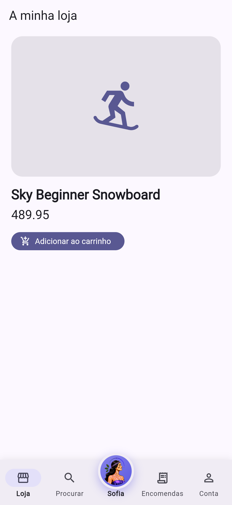
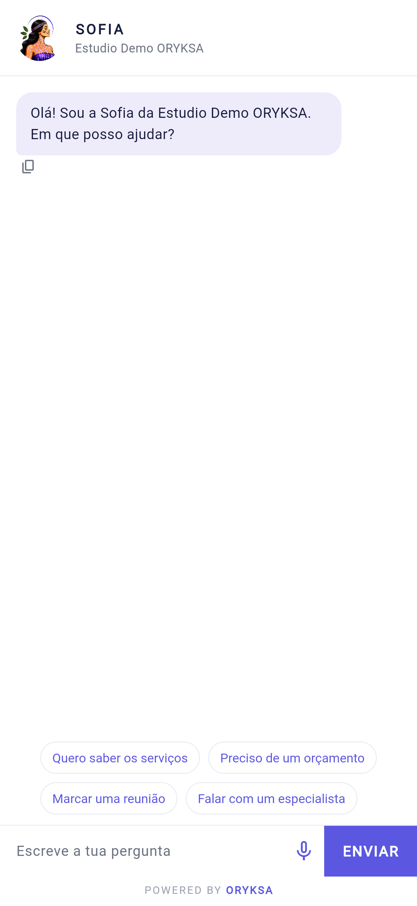
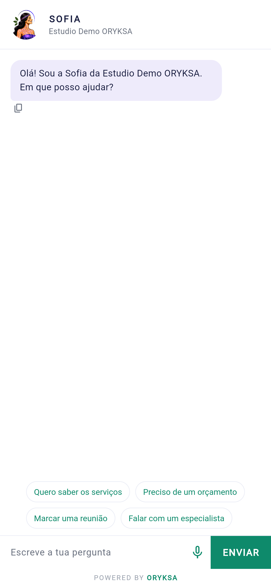

<p align="center"></p>

# oryksa

[](README.md) [](README.pt.md) [](README.es.md) [](README.fr.md)

<p align="center"><a href="https://developer.oryksa.com/pt/sdks"></a></p>

SDK oficial Flutter da **ORYKSA AI Employees**. Põe dentro da tua app Flutter (Android, iOS, web e desktop) um colaborador de IA que já conhece o teu negócio: uma bolinha redonda com a foto da tua IA no meio da tua barra de separadores, um chat pronto com o mesmo aspeto do chat do site da ORYKSA, o nome e a foto da tua IA vindos da tua conta ORYKSA, em inglês, português e espanhol.

* Documentação: https://developer.oryksa.com/pt/sdks
* API: `https://api.oryksa.com/v1`

## Capturas de ecrã

<p align="center">  </p>

Ecrãs reais da app de exemplo deste repositório (`example/`), compilada para a web pelo CI e captada no Chrome em tamanho de telemóvel, com uma conta de teste da ORYKSA. O chat verde usa o código de *Cores e tema*, mais abaixo.

## Instalar

```bash
flutter pub add oryksa
```

## Para que serve

O SDK põe o chat e a voz da ORYKSA dentro da tua app para atender os **clientes do teu negócio**: eles perguntam, compram e marcam. A IA responde com o teu Brain, os teus produtos e serviços, com o nome, a foto e a voz que escolheste em *A tua IA*, e guarda leads, marcações e vendas nas Atividades da tua conta ORYKSA. **Não** é uma interface para o dono: ninguém altera definições, lê Atividades ou dá ordens à ORYKSA através do SDK. Mais: https://help.oryksa.com/pt/a/sdks-what-they-do

Os palavrões que o cliente escreve aparecem como asteriscos no chat (a mesma lista de todos os chats da ORYKSA, carregada de `https://app.oryksa.com/widget/profanity.json` e guardada durante 24 horas). As respostas da IA já vêm filtradas do servidor.

## Bolinha na barra de separadores (1.2)

A bolinha redonda com a foto da tua IA no meio da barra de separadores inferior, igual à da app ORYKSA. Ao tocar nela, abre o chat (com o microfone para voz): ecrã inteiro nos telemóveis, um painel lateral em ecrãs largos (840 dp ou mais: tablets, dobráveis abertos, desktop), para que a tua app continue visível ao lado. O nome e a foto vêm de *A tua IA* na tua conta ORYKSA.

<p align="center"></p>

Troca o teu `NavigationBar` por `OryksaBottomBar` (os mesmos itens `NavigationDestination`):

```dart
final client = OryksaClient(getToken: myBackend.fetchOryksaToken); // devolve "oryk_cs_..."

bottomNavigationBar: OryksaBottomBar(
  client: client,
  selectedIndex: tab,
  onDestinationSelected: (i) => setState(() => tab = i),
  destinations: const [
    NavigationDestination(icon: Icon(Icons.home_outlined), label: 'Home'),
    NavigationDestination(icon: Icon(Icons.search), label: 'Search'),
    NavigationDestination(icon: Icon(Icons.receipt_long_outlined), label: 'Orders'),
    NavigationDestination(icon: Icon(Icons.person_outline), label: 'Account'),
  ],
),
```

Já tens a tua própria barra? Põe `OryksaTabBubble` no meio dela:

```dart
// na Row da tua barra
Row(children: [...leftTabs, OryksaTabBubble(client: client, showLabel: true, borderColor: barColor), ...rightTabs]);

// ou encaixada numa BottomAppBar
floatingActionButton: OryksaTabBubble(client: client),
floatingActionButtonLocation: FloatingActionButtonLocation.centerDocked,
```

* `lang`: `en`, `pt`, `br` ou `es` (ou uma etiqueta de idioma como `pt-BR`). Deixa-o a null para seguir o idioma da app (adiciona `flutter_localizations` e os teus `supportedLocales`, como no exemplo).
* `theme`: null segue o tema claro ou escuro da app (`OryksaChatTheme()` / `OryksaChatTheme.dark()`); passa um para usares as tuas cores.
* `unread: true` mostra um ponto na bolinha (por exemplo depois de uma notificação push do teu servidor no webhook `message.replied`); limpa-o em `onBubbleOpen` / `onOpen`.
* `appContext`: o ecrã em que o cliente está, enviado com cada mensagem (ver abaixo).
* Os leitores de ecrã ouvem "Talk to Sofia" ("Falar com Sofia", "Hablar con Sofia", mais "new message" quando há uma). Nas apps da direita para a esquerda, o painel lateral fica à esquerda.
* Abre o mesmo chat a partir de qualquer sítio com `showOryksaChatScreen(context, client: client)`.

**Foto da IA ou logótipo da empresa (1.2.1).** Por omissão, a bolinha mostra a foto da tua IA. Para mostrar antes o logótipo da tua empresa, escolhe "Logótipo da empresa" no painel da ORYKSA (Conectores > Chat do site): a bolinha mostra o logótipo inteiro sobre fundo branco, com o nome do teu negócio por baixo. O chat que se abre mantém a foto e o nome da tua IA. A tua app também pode impor uma imagem com `image:` no `OryksaTabBubble` (ou `bubbleImage:` no `OryksaBottomBar`), por exemplo `bubbleImage: const AssetImage('assets/logo.png')`.

## Voz e contexto da app (1.1)

O chat mostra um microfone quando o teu plano tem voz. Abre o ecrã de voz com o mesmo comportamento da app ORYKSA: o microfone fica aberto enquanto ela fala e só uma voz humana a interrompe (escrever, a TV e o eco dela própria não); ela para na palavra e o texto fica no chat; um sussurro recebe uma resposta sussurrada; se a voz dela falhar, aparece o texto (nunca uma voz de robô).

Permissões do microfone e do altifalante: Android `<uses-permission android:name="android.permission.RECORD_AUDIO"/>` e `<uses-permission android:name="android.permission.MODIFY_AUDIO_SETTINGS"/>` (a voz dela no altifalante durante a conversa; sem esta, a voz sai como multimédia), iOS `NSMicrophoneUsageDescription` no Info.plist. O botão de anexar (foto da galeria, câmara, documento; ligado por omissão, `attachments: false` esconde-o) precisa de `NSCameraUsageDescription` e `NSPhotoLibraryUsageDescription` no Info.plist; no Android não precisa de mais nada.

```dart
OryksaChatButton(
  client: client,
  lang: 'pt',
  // o ecrã em que o cliente está, para a IA responder sobre ele
  appContext: () => const OryksaAppContext(screen: 'product', title: 'Sky Beginner Snowboard, 489.95'),
)
```

## Links com botão Abrir (1.2.5)

Os links que a IA dá ficam clicáveis no chat, e cada um ganha um cartão por baixo da resposta com a foto e o título da página e um botão **Abrir** (as páginas do teu próprio site, os domínios do teu chat do site; outros sites mostram o endereço). O ecrã de voz mostra o que ela diz sem os endereços, com os mesmos cartões. Passa `onLink` para abrir os teus próprios ecrãs, por exemplo a página do produto: devolve true quando a tua app o abriu, false para o navegador o abrir.

```dart
OryksaTabBubble(
  client: client,
  onLink: (uri) {
    final id = myProductIdOf(uri); // as tuas rotas
    if (id == null) return false;
    Navigator.of(context).pushNamed('/product', arguments: id);
    return true;
  },
)
```

## As tuas funções de IA: `client.ai` (1.2.6)

Põe a IA a fazer o que a tua app precisa (ler uma foto, extrair dados, classificar, traduzir, escrever) e paga com interações ORYKSA: 1 por resposta. O teu prompt e o teu JSON Schema ficam na tua app; basta o token de sessão (nunca leves a chave secreta). Não cria conversa na tua caixa.

```dart
final r = await client.ai(
  instructions: 'Read the tyre on the photo: brand, model and size exactly as written on the sidewall. '
      'If the size is not legible, readable=false and size=null. Never invent.',
  images: [OryksaImage(photoBytes)], // JPEG, 1600 px
  schema: {
    'type': 'object',
    'properties': {
      'readable': {'type': 'boolean'},
      'brand': {'type': ['string', 'null']},
      'size': {'type': ['string', 'null']},
    },
    'required': ['readable', 'brand', 'size'],
  },
);
if (r.json?['readable'] == true) showProductsFor(r.json!['size'] as String);
```

`r.text` tem a resposta em texto, `r.json` o objeto (com schema) e `r.interactionsSpent` as interações gastas. Quando as interações do plano acabam, a chamada lança `OryksaException` com o status 402.

## Apps de TV: `package:oryksa/tv.dart` (Android TV, Google TV, Fire TV)

O que a IA faz em qualquer app de TV, só com o comando (setas, OK e Voltar), com letra grande e um foco que se vê do sofá. São widgets Flutter nativos, sem web view. Os textos, as vozes, as regras e os botões vêm da tua conta ORYKSA.

* **Apresentadora**: a IA fala no ecrã com uma voz nativa na língua de quem está a ver, com legendas grandes. As falas que ela já disse voltam a tocar a partir do aparelho, sem gerar voz nova, e são cobradas outra vez sempre que ela as diz.
* **Painel de assistente**: uma conversa com a IA feita para o comando.
* **Voz pelo telemóvel**: muitas TVs não dão microfone às apps (a Fire TV Stick não dá). A TV mostra um código QR, o telemóvel abre a página da ORYKSA e o que a pessoa diz chega à tua app como texto.
* **`client.ai`** para as tuas próprias tarefas, por exemplo moderar ou classificar.

```dart
import 'package:oryksa/tv.dart';

// Um pacote só de Dart não distingue uma Fire TV de uma Android TV: é a tua app que diz qual é.
final client = OryksaClient(getToken: tokenDoTeuServidor, platform: OryksaTvPlatform.fireTv.wire);
final tv = OryksaTv(client: client, locale: 'pt-PT');

// A apresentadora: põe o OryksaPresenterView por cima do teu ecrã.
Stack(children: [oTeuEcra, OryksaPresenterView(tv: tv)]);
await tv.presenter.say('Bem-vindos! Sou a vossa apresentadora esta noite.');
await tv.presenter.sayGenerated(instructions: 'Anuncia a próxima ronda numa frase curta.', input: 'Ronda 2');
// Só legendas, sem som (cobrada ao preço de texto; uma fala com voz é cobrada ao preço de voz).
await tv.presenter.say('O tema desta noite: viagens.', voice: false);

// O painel de assistente (o Voltar fecha-o e o foco volta para onde estava).
showOryksaTvAssistant(context, tv: tv);

// O telemóvel como microfone.
tv.phoneVoice.texts.listen((texto) => quandoOEspectadorDisse(texto));
showDialog(context: context, builder: (_) => Dialog(child: OryksaPairingCard(tv: tv)));
```

* **Sem servidor próprio**: `OryksaClient.public(chatToken: ..., conversationId: ..., platform: OryksaTvPlatform.fireTv.wire, appId: 'o.teu.package')` abre uma sessão pública com o token público do chat do teu negócio. Quando o teu negócio limita o chat, tem de pôr o teu package na lista de apps permitidas. O `appId` é um filtro, não é segurança forte (pode ser imitado): a segurança forte é o token vir do teu próprio servidor (`POST /v1/sessions`).
* **Línguas**: o servidor da ORYKSA escolhe a voz e os textos para o locale. Há vozes nativas para pt-BR, pt-PT, es-ES, es-419, fr-FR, de-DE, en-US e en-GB, e as outras línguas usam a voz de inglês dos EUA.
* **Interações**: cada fala da apresentadora é cobrada pela tabela de custos de interação da ORYKSA sempre que ela a diz ou a mostra (por cada pedaço de até 600 caracteres), também a fala repetida e a fala só com legendas: a fala com voz ao preço de voz e a fala só com legendas ao preço de texto. O número exato vem no cabeçalho `X-ORYKSA-Interactions-Spent`, e uma fala que o servidor não contou não aparece. Cada texto ouvido no telemóvel, cada resposta do chat e cada resposta do `client.ai` também são cobrados.
* **Enquanto ela fala**, o OK e o Voltar do comando calam-na (`remoteSkips: false` desliga isso). Usa `tv.presenter.onStart` e `onEnd` para baixar a tua música ou o teu vídeo.
* **Microfone da TV**: `OryksaTvMic.isAvailable()` diz se o aparelho tem uma entrada de áudio. O SDK nunca pede a permissão numa TV que não a tem.
* **AndroidManifest**: declara o microfone, o ecrã tátil e o leanback como não obrigatórios, para as lojas não esconderem a tua app nas TVs que não os têm, e acrescenta a categoria do lançador de TV com um banner. Vê `example_tv/` no repositório.

```xml
<uses-feature android:name="android.hardware.microphone" android:required="false"/>
<uses-feature android:name="android.hardware.touchscreen" android:required="false"/>
<uses-feature android:name="android.software.leanback" android:required="false"/>
<!-- no intent-filter da atividade -->
<category android:name="android.intent.category.LEANBACK_LAUNCHER"/>
```

Para testes e demonstrações, `OryksaTv.withBackend(OryksaTvFakeBackend())` corre tudo sem o servidor. É simulado, por isso não prova nada sobre a tua conta ORYKSA.

## Como funciona (e porque é que a chave fica segura)

1. O teu **servidor** guarda a chave secreta da API (`oryk_live_...`, criada em developer.oryksa.com) e cria um **token de sessão** de curta duração para cada utilizador com sessão iniciada, com `POST /v1/sessions`.
2. A tua **app** recebe só esse token de sessão (`oryk_cs_...`) e fala com a ORYKSA através dele. A chave secreta nunca entra na app.
3. Cada resposta da IA conta como uma interação do teu plano ORYKSA, tal como no WhatsApp.

## Na app

```dart
import 'package:oryksa/oryksa.dart';

final client = OryksaClient(
  getToken: () async => await myBackend.fetchOryksaToken(), // devolve "oryk_cs_..."
);

Scaffold(
  body: MyScreen(),
  floatingActionButton: OryksaChatButton(client: client, lang: 'en'), // en, pt, br, es
);
```

Abre-o a partir do teu próprio botão com `showOryksaChat(context, client: client)`, ou coloca o painel em qualquer sítio com `OryksaChat(client: client)`. Muda as cores com `OryksaChatTheme`.

Sem a interface:

```dart
final agent = await client.agent();            // nome, foto, saudação, sugestões
final text = await client.sendAndWait('Are you open on Saturday?');
final history = await client.messages();
```

## No teu servidor Dart (chave secreta)

As funções de servidor estão numa biblioteca à parte, **só para o teu backend**: nunca a importes na app. A biblioteca da app (`package:oryksa/oryksa.dart`) serve apenas os teus clientes e não pode alterar a IA nem o Brain dela.

```dart
import 'package:oryksa/oryksa_server.dart';

final oryksa = Oryksa(Platform.environment['ORYKSA_API_KEY']!);

// token de sessão para um utilizador (envia só o client_token para a app)
final s = await oryksa.createSession(conversationId: 'user-42', customerName: 'Ana');

// mantém a IA sincronizada com a tua app (chama-o em cada versão)
await oryksa.learnApp(
  name: 'FitTrack',
  description: 'Fitness app to log workouts and follow training plans.',
  screens: [{'title': 'Workouts', 'content': 'Tap + to log a workout.'}],
  faq: [{'question': 'How do I cancel Premium?', 'answer': 'Settings > Subscription > Cancel.'}],
);
```

Servidores noutras linguagens podem chamar a mesma API: vê https://developer.oryksa.com.

## Webhooks

```dart
import 'package:oryksa/oryksa_server.dart';

final event = verifyWebhook(rawBody, request.headers['oryksa-signature'], webhookSecret);
```

## Erros

Cada chamada falhada lança `OryksaException` com `status`, `code` (por exemplo `interaction_limit_reached`, `rate_limited`, `plan_required`) e `message`.

## Cores e tema

O `OryksaChatTheme` tem seis cores: `accent` (botões, balões do visitante, ligações), `ink` (texto principal), `soft` (balões da IA), `background` (painel), `muted` (texto secundário) e `line` (separadores). `OryksaChatTheme()` é a versão clara e `OryksaChatTheme.dark()` a escura. Passa o tema a `OryksaChatButton`, `OryksaChat`, `showOryksaChat` ou `OryksaTabBubble`.

```dart
// Your own colors (light)
OryksaChatButton(
  client: client,
  theme: const OryksaChatTheme(accent: Color(0xFF0E8A6B)),
);

// Dark version, with your accent
OryksaChatButton(
  client: client,
  theme: const OryksaChatTheme.dark(accent: Color(0xFF3DD9A8)),
);
```

O `OryksaTabBubble` e o `showOryksaChatScreen` seguem o tema claro ou escuro da tua app quando não passas nenhum tema (`OryksaChatTheme.of(context)`).

---

## Sobre o autor

**Weslley Harakawa** - Fundador da ORYKSA AI. Em Lisboa, Portugal. Especialidades: inteligência artificial, desenvolvimento web e mobile, tokenização em blockchain. Formação: University of the People.

- LinkedIn: https://www.linkedin.com/in/weslleyharakawa/
- ORYKSA AI Employees: https://oryksa.com (X: https://x.com/oryksa, Instagram: https://www.instagram.com/oryksaai, YouTube: https://www.youtube.com/@ORYKSA)

---

MIT License · ORYKSA AI Employees · W8 Atlantic Unipessoal Lda
